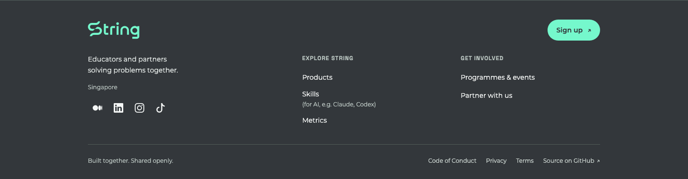

# String footer

A shared footer for String's landing page, String ID, String Skills and String Bingo. Static markup, scoped CSS and a local copy of the existing approved String logo (with its SVG viewport cropped to remove excess whitespace; paths and colours are unchanged). No runtime package, external script or JavaScript requirement for the HTML/Astro footer.

`footer.html`, `footer.css` and `string-logo.svg` are the canonical v1.0.0 source. `sync.mjs` generates native Astro/React components or static HTML and selects each product's GitHub source link. Products commit generated files plus `string-footer.json` with the source version and SHA-256 digest. The digest covers the template, CSS and logo in that order.

From a reviewed checkout of this repository:

```sh
node components/string-footer/sync.mjs landing /path/to/string-sg-landing
node components/string-footer/sync.mjs id /path/to/string-id
node components/string-footer/sync.mjs skills /path/to/str-skills
node components/string-footer/sync.mjs bingo /path/to/bingo-string
```

Requires Node.js 20+. Add `--check` to detect drift without writing. The script checks the target package name, writes only footer assets/manifest, and updates marked footer regions in Bingo's `index.html` and `new.html`. It refuses incomplete marker pairs. React/Astro layout integration is explicit: import `StringFooter` once after the main content. CSS is bundled by the app's existing tooling. Assets live under `/string-footer/`, so the products are expected to deploy at their domain root.

Make shared changes here first, regenerate consumers, run each app's checks and review the diffs in separate PRs. Increment the version in the script and CSS comment for the next release. Pin this branding checkout to the reviewed commit when reproducing a release; no product build fetches mutable upstream code. The branding PR must merge before the documentation links to `main` resolve.

The footer includes product navigation, community links, Medium, LinkedIn, Instagram, TikTok, Privacy, Terms, and each product's GitHub source. Only String ID includes Code of Conduct, pointing to its local `/conduct` route. TikTok uses the owner-confirmed `https://www.tiktok.com/@string.sg` profile. Links use the current tab; the source arrow is decorative. Fonts use the app's existing font setup and system fallbacks. Keyboard focus, forced-colour focus, wrapping and a two-column mobile layout are included. Application actions, signing gates, integration endpoints and creator credits remain product-owned.

Reusable agent guidance: [string-footer skill](../../.claude/skills/string-footer/SKILL.md). To install it locally, copy that folder into your agent's skills directory.

## Preview

Captured from the String ID integration at 1440px and 375px, with local API responses mocked for the preview.




## Existing shell migration PRs

The earlier String ID #82 and String Skills #8 PRs introduce `@string-sg/ui` header/footer wrappers. Their 0.1.0 `AppFooter` is only a generic container; it does not contain this footer's content. The new footer integrations replace the application footer independently. When combining those PRs, retain the earlier `AppHeader`/`Brand` changes and use one `StringFooter` after main content, removing the old `AppFooter` import and wrapper. Do not nest the two footers. This component is kept in the existing brand-guide repository so later packaging can use the same canonical source.

## Navigation and icon conventions

Explore String links to Products (`https://string.sg/products/`), Skills (`https://skills.string.sg/`, explained as “for AI, e.g. Claude, Codex”), and Metrics (`https://reports.string.sg/`). Bingo is not promoted in this navigation. The top-right Sign up CTA points to `https://id.string.sg/`. Medium, LinkedIn, Instagram and TikTok use icon-only links with accessible names, title tooltips and keyboard focus. Inline icons come from [Bootstrap Icons](https://github.com/twbs/icons), distributed through react-icons 5.7.0; the upstream MIT licence is included here and vendored with each consumer. No icon font, runtime icon library or remote icon request is needed.
